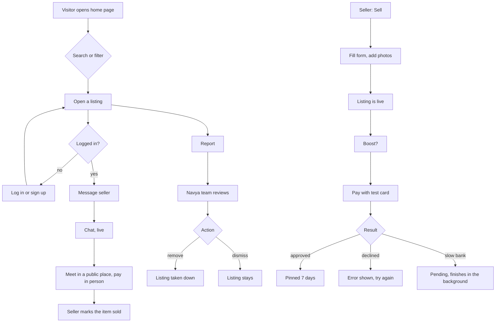

# Store and platform flow

> Subject: E-Commerce | Deliverable: store or platform flow | Data: real, each step is covered by an automated test or the browser test

## Pages

Home with search, chips, filters and paging. Listing detail with photos, seller card, save, message, report. Sell and edit form. My listings. Chats and chat screen. Seller profile. Boost and Orders. Reports (team only).

## Error paths that are handled

Sold listing (chat refused). Own listing (chat and report refused). Declined card. Slow bank (pending, then settled by the background thread). Expired login (sent back to log in). Photo that is not a JPEG or is too large. Fifth photo. Wrong owner on edit, delete, status, boost. Rate limits on login, sign-up, writes, uploads, messages and payments.
