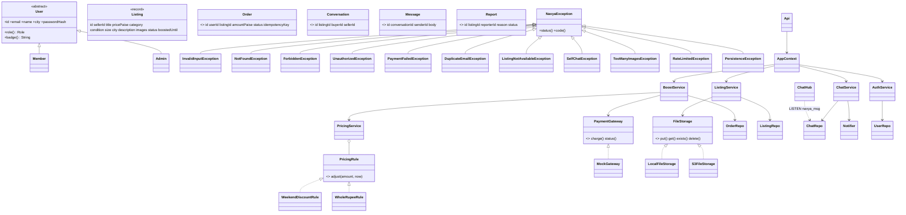
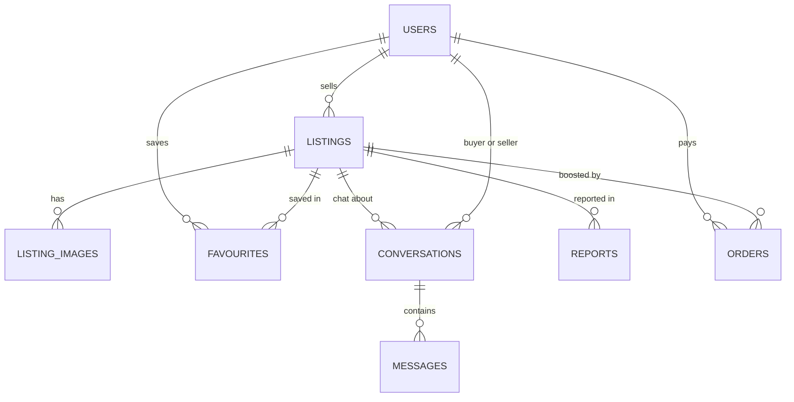
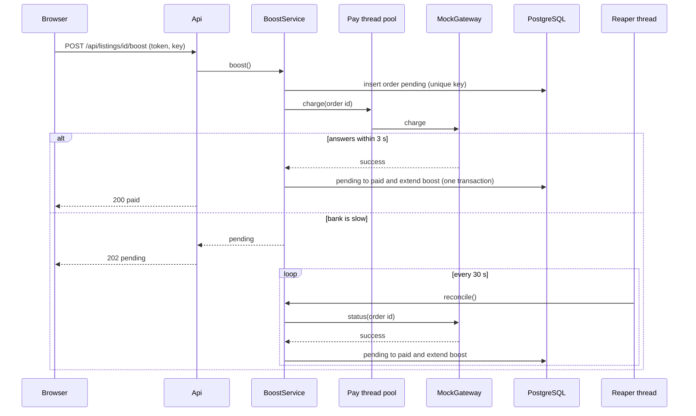
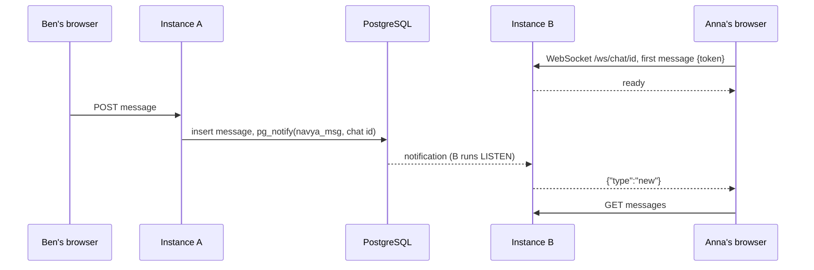

# UML and design diagrams

> Subject: Java | Deliverable: UML diagram | Data: real, drawn from the code in `src/main/java/com/navya`. Mermaid renders on GitHub.

## Classes

## Data model

Constraints that matter: unique `lower(email)`, unique `(listing_id, buyer_id)` on conversations, `buyer_id <> seller_id`, `status` and `category` check lists, `price_paise` range, message length 1 to 2,000, unique `idempotency_key` on orders. Full schema: `src/main/resources/db/schema.sql`.

## Boost payment, with a slow bank

## Live chat across two instances

## Threads

| Thread | Created in | Job |
|---|---|---|
| `qtp-*` (64 max) | Javalin | Request handling, bounded queue of 500 |
| `navya-pay-1..8` | `AppContext` | Payment calls with a 3 s timeout |
| `navya-reaper` | `AppContext` | Every 30 s: expire old listings, settle slow payments |
| `navya-notifier` | `Notifier` | Writes notices from a queue to `outbox.log` and the log |
| `navya-chat-listener` | `ChatHub` | Holds the `LISTEN` connection, pings WebSocket sessions |

## Deployment view

See `../5-Cloud-Computing/01-cloud-architecture-design.md`.
