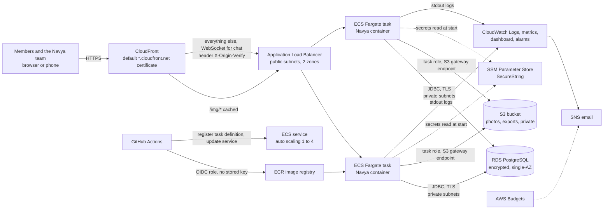
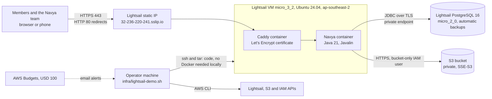

# Cloud architecture design

> Subject: Cloud Computing | Deliverable: architecture diagram and justification of provider and service models | Data: design is real (it is the template in `navya/infra/main.yaml`, linted with cfn-lint).

## Why the cloud helps Navya

- Traffic comes in waves: weekends, and the start and end of semesters when people move in and out of hostels. Managed containers can add capacity for the wave and remove it. A single fixed server either idles or struggles.
- Members across many colleges reach one HTTPS address. No install.
- Photos need durable storage, and the database needs backups and a restore path. Both are managed services here.
- Chat needs several app instances to agree. A managed database with notifications (`LISTEN/NOTIFY`) does that without another system.

## Diagram

## Architecture actually deployed (2026-11-25)

The diagram above is the design. What runs is smaller, because the account could not create CloudFront and had a short list of allowed regions and services (`11-demo-deployment-record.md`).

| Need | Service | Model | Why |
|---|---|---|---|
| Run the container | Lightsail VM with Docker Compose | IaaS (a virtual server we manage) | The one compute service the account could create in an allowed region. Fixed price (USD 7 a month). WebSockets and background threads work as on a laptop. |
| HTTPS | Caddy and Let's Encrypt, on a free `sslip.io` name | Software we run | CloudFront was refused for the account. Needs a hostname but not a purchased domain. |
| Database | Lightsail managed PostgreSQL | PaaS (managed) | Backups and patching are managed. Private endpoint. USD 15 a month. |
| Photos | S3 | PaaS | Same as the design. |
| Identity | One admin IAM user for the operator, one bucket-only IAM user for the app | n/a | A VM has no instance role, so the app uses a key kept in the VM's `.env`. |

Not in the demo: load balancer, auto scaling, a second instance, CloudWatch, CloudFront, a custom domain. Cost about USD 22 a month. Components in the brief's list: users (browser), web layer (Caddy), Java application (container), storage (S3), database (Lightsail PostgreSQL).

## Components of the design (not deployed)

Components in the brief's list: users (browser), web layer (CloudFront and the ALB), Java application (ECS tasks), storage (S3), database (RDS). Support: registry (ECR), secrets (SSM), IAM roles, logging and alarms (CloudWatch and SNS), CI (GitHub Actions), budget (AWS Budgets).

## Provider and region

AWS. The design targeted `ap-south-1` (Mumbai) because the users are in India, and the cost sheet uses Mumbai prices. The account's AWS Organization allows only `us-east-1`, `us-west-2` and `ap-southeast-2` (Sydney) for ordinary services, so the deployment uses Sydney (`11-demo-deployment-record.md`). Round trips from the development machine to Sydney take about 0.4 s. Why AWS and not another provider: the team has AWS credit options (see `10-operations-clean-up-and-limits.md`), the services map one to one to what the brief lists, and the infrastructure is code (CloudFormation) in the repository. The earlier FestPass project used Azure with the same shape (container platform, managed PostgreSQL, object storage), so this design is portable.

## Service choices and models

| Need | Service | Model | Why this one |
|---|---|---|---|
| Run the container | ECS on Fargate | PaaS (containers) | No servers to patch. Scales by task count. The app keeps WebSocket connections open and uses background threads, which suit a long-running container better than Lambda. |
| Entry point and HTTPS | CloudFront | PaaS | Free default HTTPS certificate on a `*.cloudfront.net` address (no domain purchase), caches photos, passes WebSockets. |
| Balance and health-check | Application Load Balancer | PaaS | Spreads load over tasks, replaces unhealthy ones, 5 minute idle timeout for chat. |
| Database | RDS for PostgreSQL | PaaS (managed) | The app needs transactions, unique constraints and `LISTEN/NOTIFY`. Backups and patching are managed. |
| Photos and exports | S3 | PaaS | Cheap, durable, private by default, lifecycle rules. |
| Image registry | ECR | PaaS | Private images next to ECS, scan on push. |
| Secrets | SSM Parameter Store (SecureString) | PaaS | Free for standard parameters. Secrets Manager costs per secret. |
| Identity | IAM roles | n/a | Task role, execution role and CI role, no long-lived keys. |
| Logs, metrics, alarms | CloudWatch, SNS | PaaS | Built in, no agent. |
| Pipeline | GitHub Actions | SaaS | The repository is on GitHub. |
| Cost control | AWS Budgets | SaaS | Email alerts at 50%, 80% and a forecast of 100%. |

Summary of models: PaaS for compute, database and storage. SaaS for the pipeline. No self-managed virtual machines (no IaaS in the main design). A single machine with Docker Compose was the documented fallback if Fargate or the load balancer cost too much, and it is what was deployed (on Lightsail, see above).

Not chosen: Lambda (WebSockets and background threads), App Runner (I recall it closing to new customers in 2026, not verified), Aurora (cost), DynamoDB (the app uses relational constraints), a NAT gateway (hourly cost, avoided with public task IPs).

## Network

One VPC (10.20.0.0/16) in two availability zones. The load balancer and tasks are in public subnets. The database is in private subnets that have no route to the internet.

| Security group | Allows in | From |
|---|---|---|
| Load balancer | TCP 80 | The AWS-managed CloudFront prefix list only |
| App tasks | TCP 8080 | The load balancer group only |
| Database | TCP 5432 | The app group only |

Tasks get a public IP so they can pull their image and reach AWS APIs without a NAT gateway (which bills by the hour). The security group still allows nothing inbound except from the load balancer. An S3 gateway endpoint keeps photo traffic on the AWS network and is free.

**Limit to state:** CloudFront reaches the load balancer over plain HTTP on port 80, because a load balancer cannot hold a certificate for a `*.cloudfront.net` name. The load balancer refuses any request that lacks the secret `X-Origin-Verify` header, and only CloudFront addresses can reach it. A custom domain with an ACM certificate would allow HTTPS between CloudFront and the load balancer.

## Request path

Browser to CloudFront over HTTPS (HTTP is redirected). CloudFront adds the secret header and forwards to the load balancer, which forwards to a healthy task on port 8080. `/img/*` is cached at the edge for as long as the app's one-year `Cache-Control` allows (photo names are random and never reused). WebSocket upgrades for chat go the same way and are not cached.
